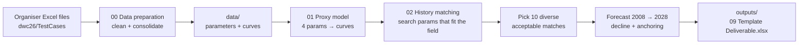

# DWC26: ML-Assisted History Matching and 20-Year Production Forecast

ExxonMobil DataWorks Challenge 2026. The organisers ran a reservoir simulator 100 times, each time with a different
setting of four uncertain reservoir parameters, and gave us the real field's production history for 1998–2008.
The task is to find which parameter settings reproduce that history (**history matching**) and to forecast oil, gas
and water production for the **10 best matches** from 2008 to 2028.

The approach in one line: **train a fast ML proxy of the simulator → use it to search for parameters that match the
real field → forecast the 10 best matches to 2028 → fill the organiser's template.**

## Results at a glance

| | Value |
|---|---|
| Proxy accuracy on unseen simulations | < 0.1 % error on 2008 oil and water cumulatives (Gaussian Process) |
| Best history match | misfit **0.442**, better than every provided simulation (best: case 76, 0.453) |
| Parameter the history pins down | **Porosity multiplier ≈ 1.38** (recovered within ~1 % of its range in the blind test) |
| First forecast quarter vs real data (2008-Q1, unseen) | oil **+1.3 %**, water **−0.3 %** |
| Field cumulatives at 2008-01-01 (observed) | 38.4 MMSTB oil, 13.9 MMMSCF gas, 12.8 MMSTB water |

Forecast cumulatives at **2028-01-01** across the 10 delivered cases:

| | P10 | P50 | P90 |
|---|---|---|---|
| Oil [MMSTB] | 55.94 | 56.20 | 56.44 |
| Gas [MMMSCF] | 20.32 | 20.42 | 20.50 |
| Water [MMSTB] | 86.22 | 87.81 | 89.29 |

The deliverable is [outputs/09 Template Deliverable.xlsx](outputs/09%20Template%20Deliverable.xlsx). The P10–P90
range reflects parameter uncertainty only; see [Limitations](#limitations).

---

## Workflow



| Stage | Where | What it does |
|---|---|---|
| 1. Data preparation | [notebook/00_DWC2026.ipynb](notebook/00_DWC2026.ipynb) | Cleans the raw case files and aligns all curves to the 41 quarterly dates |
| 2. Proxy training and prediction | [notebook/01_Proxy_Model.ipynb](notebook/01_Proxy_Model.ipynb) | Compares proxy models and forecast methods, then picks one of each |
| 3. History matching and forecast | [notebook/02_History_Matching_Forecast.ipynb](notebook/02_History_Matching_Forecast.ipynb) | Optimisation, validation, final forecast and deliverable |
| Same as stage 3, no charts | [pipeline/](pipeline/) | `python -m pipeline.main` runs the full chain end to end |

---

## Data

### Organiser files (`dwc26/TestCases/`, not in git)

| File | Contents | Used for |
|---|---|---|
| `01 Introduction.xlsx` | Nomenclature, plus the 4 uncertainty parameters for each of the 100 cases | Model **inputs** |
| `02 Field Production.xlsx` | Simulated rate and cumulative curves for all 100 cases, plus the **observed field history** (`RAMP_History` column / `Field Production` sheet) | Model **targets** and history-matching **target** |
| `03`–`06 Train Cases 1–4.xlsx` | Cases 1–70: grid-block data (porosity, permeability, saturations…) and curves, 160–330 MB each | Training split (grid data cleaned in stage 1) |
| `07 Validation Cases.xlsx` | Cases 71–85, same format | Validation split |
| `08 Test Cases.xlsx` | Cases 86–100, same format | Test split |
| `09 Template Deliverable.xlsx` | 10 empty sheets, quarterly 2008-04-01 → 2028-01-01 | The deliverable format |

### The four inputs

| Parameter | Range in the 100 cases | Meaning |
|---|---|---|
| Fault Transmissibility | 0.05 – 0.15 | How easily fluid crosses faults |
| Porosity Multiplier | 0.80 – 1.49 | Scales pore volume, so it scales how much oil is in place |
| Permeability Multiplier | 0.52 – 9.79 | Scales how easily fluid flows (used on a log scale) |
| Aquifer Pore Volume | 54 – 200 | Size of the water aquifer pushing into the reservoir |

Each case is **one training sample**: 4 numbers in → oil, gas and water curves out. Cases 1–70 are for training,
71–85 for validation (model choice) and 86–100 for testing (reported once).

### Prepared data (`data/`, in git)

| File | Built by | Contents |
|---|---|---|
| `01 Introduction.xlsx` | copy | The parameter table |
| `Simulation_Rates_Consolidated.xlsx` | stage 1 | `02 Field Production.xlsx` rate sheets reshaped to long format (Date, Case, oil, gas, water) |
| `Simulation_Cumulatives_Consolidated.xlsx` | stage 1 | Same, for cumulatives |

The values are identical to the original (checked: 0 difference). One detail matters: the **observed field history
appears as the rows labelled `UNKNOWN_COL_101`**. The original column `RAMP_History` lost its name during
consolidation. Stage 2 drops these rows because it only needs simulations; stage 3 reads them as the matching target.

### Why the grid data is not a model input

The grid files describe the simulator's *internal state* for each case. For a new parameter set (which is what the
optimiser proposes) there is no grid data unless the simulator is run, and replacing the simulator is the reason the
proxy exists. The grid data is also a consequence of the 4 parameters, so it adds no independent information: the
millions of grid rows repeat the same 70 training cases cell by cell.

---

## Methodology

### 1. Data preparation ([00_DWC2026.ipynb](notebook/00_DWC2026.ipynb))

- Replaced the simulator's inactive-cell value `-999.25` with NaN. Kept only grid blocks with valid properties, and
  saved them as Parquet files split by case.
- Aligned each simulation curve to the 41 observed quarterly dates (1998-01-01 → 2008-01-01). Exported the
  two consolidated curve files above.

### 2. What the data tells us (exploration in [01_Proxy_Model.ipynb](notebook/01_Proxy_Model.ipynb))

These findings shaped every later decision:

- **Gas is not independent.** The gas/oil ratio is 0.360–0.365 MSCF/STB in every case and quarter: the reservoir stays
  undersaturated. Gas is predicted as GOR × oil and is left out of the history-match misfit.
- **Total liquid rate is a well-control schedule**, almost the same in all cases (max/min ≈ 1.11). The uncertainty
  shows up in *how the liquid splits* between oil and water (water cut).
- **Porosity dominates.** Spearman correlation with 2008 oil cumulative: porosity 0.99, aquifer −0.22, fault 0.20,
  permeability 0.00.
- **Two date conventions.** Simulated rates are averages over the quarter that *ends* at the date. Observed rates are
  averages over the quarter that *starts* at the date (the field starts producing at 1998-10-01 in the observed data
  and at 1999-01-01 in every simulation, with the same value). Observed rates are shifted one quarter later before any
  comparison. Cumulatives are rebuilt from rates with the right-point rule plus a small calibrated correction
  (≈ 1.007 for oil, 0.996 for water).

### 3. Proxy model: 4 parameters → 1998–2008 curves

**Design.** Each case's 6 curves × 41 quarters (246 values) are scaled per curve type and compressed with **PCA**
(24 components). A regressor maps the 4 parameters to the PCA scores, and inverting
the PCA rebuilds all curves at once. Post-processing enforces physics: rates ≥ 0, cumulatives non-decreasing.

**Compared on validation cases 71–85** (combined score, lower is better):

| Regressor | Validation score | Final-cum error, oil / water (validation) | Final-cum error, oil / water (test) |
|---|---|---|---|
| Ridge on cubic polynomial features (classic response surface) | 0.514 | 0.108 % / 0.450 % | 0.126 % / 0.311 % |
| **Gaussian Process** (Matérn 5/2, one length scale per parameter) | **0.087** | **0.023 % / 0.113 %** | **0.026 % / 0.104 %** |
| MLP ensemble (5 neural networks averaged) | 1.012 | 0.982 % / 2.282 % | 0.928 % / 1.700 % |

**Decision: Gaussian Process.** It is the most accurate by a wide margin, and it suits small designed experiments
(70 training samples). It is also smooth, which helps the optimiser. The neural network is the weakest here: 70
samples are too few for it.

**Sensitivity (tornado, P10 → P90 swing of one parameter, others at median).** Oil at 2028: porosity +7.41 MMSTB,
permeability +0.93, aquifer −0.05, fault −0.005. Water: porosity −6.10, aquifer +0.48. So we expected history matching
to pin down porosity well and fault transmissibility poorly, and it did.

### 4. Forecast method: 2008 → 2028

The simulations stop at 2008, so **no training target exists for the forecast window**. Two approaches were built in
stage 2 and judged on a **backtest**: everything was retrained on data up to 2006-01-01 and asked to forecast the
held-out 2006-04 → 2008-01 quarters.

| Approach | Idea |
|---|---|
| **A: proxy + decline curves** | Arps hyperbolic decline on oil rate and exponential decline on total liquid, fitted to the last 5 quarters of (proxied) history. Water = liquid − oil, gas = GOR × oil. Physics-shaped, so it cannot produce unphysical curves. |
| B: autoregressive GRU | A recurrent neural network, conditioned on the 4 parameters, that steps liquid rate and water cut forward one quarter at a time |
| Blend | (A + B) / 2 |

| End-to-end backtest (parameters only) | Final-cum error, validation | Final-cum error, test |
|---|---|---|
| **A: proxy + decline** | **1.541 %** | **1.499 %** |
| B: GRU | 1.784 % | 1.683 % |
| Blend | 1.618 % | 1.518 % |

**Decision: Approach A**, with a 5-quarter decline window (best of 5, 8 and 13 on validation backtests). The GRU's
water rate drifts down right after the cutoff, which is physically implausible while water cut is still rising. The
two approaches also disagree strongly by 2028 (mean oil 54.6 vs 61.6 MMSTB, water 84.2 vs 60.2 MMSTB on the same
cases), which is a reminder of how uncertain long-range extrapolation is.

### 5. History matching: the optimisation step ([02_History_Matching_Forecast.ipynb](notebook/02_History_Matching_Forecast.ipynb))

**Proxy for matching.** Retrained on all 100 cases. On cases 86–100, held out when trained on 1–85: 2008
cumulative error 0.020 % oil and 0.085 % water on average.

**Misfit (what "a good match" means).** For a parameter set, the proxy predicts oil rate, water rate, oil
cumulative and water cumulative for 1998–2008. Each is compared with the observed field quarter by quarter. Each
residual is divided by an assumed measurement error σ: 3 % of the peak observed rate for rates, 2 % of the final
observed value for cumulatives. The residuals are squared and averaged within each block, then across the four
blocks. **Misfit = 1** means the curves are on average one σ from the data. Of the 100 provided simulations, the best
scores 0.453 (case 76) and the median 8.08.

**Optimiser: Sobol screening + L-BFGS-B polishing** ([pipeline/history_match.py](pipeline/history_match.py)):

1. **Search box** = the parameter range spanned by the 100 cases, so the proxy never extrapolates. Permeability is
   searched on a log scale.
2. **Global scan:** 8,192 Sobol points (an evenly spread quasi-random design) over the box.
3. **Local polish:** L-BFGS-B (gradient-based, bounded) from the 40 best distinct points, so no promising valley is
   missed.

**Selection of the 10 deliverable cases.** No parameter set gets below a misfit of ~0.44. The field produces more
water late in life than any simulation can (field ~60 % water cut at 2008, best match ~54 %). Differences of a few
percent above that floor are not meaningful. So every point within **10 % of the best misfit** counts as an
*acceptable match* (201 points). From those, 10 are chosen by **farthest-point sampling**: start from the best match,
then repeatedly add the point most different from those already picked. The 10 forecasts then express the remaining
parameter uncertainty instead of being ten copies of one answer.

**Result.** Best misfit 0.442. All acceptable matches sit in a thin band at **porosity ≈ 1.34–1.40**, while fault
transmissibility spans almost its whole range. The history does not constrain it, and the forecast barely depends on
it.

### 6. Optimiser comparison: Differential Evolution (Section 7b of notebook 02)

We tested whether a different optimiser finds a better match or the same match more cheaply. **Differential
Evolution (DE)** evolves a population of 60 parameter sets: each trial mixes the differences between members and
replaces its parent only if it scores better, and the run finishes with an L-BFGS-B polish. DE is in the pipeline as
`history_match_de()`, with the same inputs, outputs and selection rule. Both methods ran with 3 seeds:

| | Sobol + L-BFGS-B | Differential Evolution |
|---|---|---|
| Best misfit (all seeds) | 0.4422 | 0.4422 (same parameters) |
| Proxy evaluations | ~15,000 | ~3,300 (5× fewer) |
| Time | ~30–40 s | ~1 s |
| Permeability range covered by the selected 10 | 72 % | 59 % |
| 2028 oil P50 | 56.20 MMSTB | 56.05 MMSTB (−0.3 %) |
| 2028 water P10–P90 width | 3.1 MMSTB | 2.2 MMSTB |

**Decision: keep Sobol + L-BFGS-B.** Both find the same global optimum, so changing the optimiser doesn't improve
the match. DE is much cheaper, but it homes in quickly and explores the edges of the acceptable region less, so its
narrower forecast range comes from exploring less, not from more certainty. With an instant proxy, 30 s is no real
cost. DE would be the better choice if each evaluation were expensive (for example, the real simulator).

### 7. Validation

**Blind test: can the matcher find a known answer?** Each test case 86–100 had its own simulated history treated
as "observed". The case was matched with a proxy trained only on cases 1–85, and the recovered parameters were
compared with the true ones.

| | Mean | Max |
|---|---|---|
| Porosity error (% of range) | 0.77 | 1.84 |
| Permeability error (% of range) | 9.3 | 45.8 |
| Aquifer error (% of range) | 9.7 | 28.6 |
| Fault transmissibility error (% of range) | 40.8 | 94.7 |
| 2028 oil cumulative difference vs truth | −0.51 % | 1.58 % |
| 2028 water cumulative difference vs truth | 0.45 % | 5.44 % |

Porosity is recovered almost exactly. Fault transmissibility is not, because the history contains little information
about it. Even when parameters differ, the **forecast** from recovered parameters stays within ~0.5 % of the truth
on average.

**Field backtest: which forecast variant works on the *real* field?** The real observations were matched up to a
cutoff (2005-01, 2006-01 and 2006-07), and the held-out quarters were forecast and compared with what the field did:

| Method (mean of 3 cutoffs) | Oil rate MAPE | Oil Δcum error | Water rate MAPE | Water Δcum error |
|---|---|---|---|---|
| A: matched model | 3.52 % | 3.97 % | 11.67 % | 12.16 % |
| **A+: matched model, anchored** | **1.95 %** | **2.08 %** | 9.30 % | 10.04 % |
| D: decline on observed data only | 5.82 % | 5.44 % | **6.28 %** | **6.96 %** |

**Decision: A+ (anchored).** The matched model supplies the decline *shape*; the forecast rate is rescaled so it
starts from the last observed rate, and cumulatives start from the observed 2008 values. This removes the jump caused
by the late-time water-cut gap. A+ is best for oil, the main product. D is better for water, which is the least
certain phase whatever the method.

**Out-of-sample check.** The data holds one real quarter beyond the simulations (2008-01 → 2008-04), which neither
the proxy nor the matcher has seen. A+ predicts it within **+1.3 % (oil) and −0.3 % (water)**; unanchored A misses by
+14.4 % and −10.0 %.

### 8. Deliverable

The 10 selected cases are forecast with A+ and written into the **official** template (`dwc26/TestCases/09 Template
Deliverable.xlsx`). Only the value cells are written, so the dates and formatting are unchanged. Sheet `Case k` = the
k-th selected case, ranked by misfit. The notebook asserts that the output has the template's shape and dates, no
blanks, and cumulatives that never decrease. The output is `outputs/09 Template Deliverable.xlsx`, which is also the
Power BI source.

---

## Decision log

| Decision | Alternatives considered | Why | Evidence |
|---|---|---|---|
| Inputs = 4 case parameters only | Grid-block features | Grid data is unavailable for new parameter sets and is determined by the parameters | Section [Data](#why-the-grid-data-is-not-a-model-input) |
| Gas = GOR × oil; no gas in the misfit | Model gas separately | GOR is constant (0.360–0.365) in every case | Exploration |
| Shift observed rates one quarter | Compare as published | The two date conventions differ; the shifted data matches the simulations' first production exactly | Notebook 02 §3 |
| PCA + Gaussian Process proxy | Ridge, MLP ensemble | Lowest validation error (score 0.087 vs 0.514 / 1.012) | Notebook 01 §5 |
| Forecast = decline curves (Approach A) | GRU, blend | Lowest end-to-end backtest error, physically plausible | Notebook 01 §7 |
| Optimiser = Sobol + L-BFGS-B | Differential Evolution | Same optimum; wider coverage of acceptable region; speed not a constraint | Notebook 02 §7b |
| Accept within 10 % of best, then farthest-point sampling | Top 10 by misfit | Misfit floor ~0.44 makes small differences meaningless; diversity shows real uncertainty | Notebook 02 §7 |
| Anchor forecast to last observed rate (A+) | Unanchored A, decline on observed only | Best oil error in field backtest; +1.3 % on the unseen 2008-Q1 | Notebook 02 §9–10 |

## Key findings

1. **Porosity drives everything.** Its rank correlation with 2008 oil is 0.99, it swings 2028 oil by 7.4 MMSTB on its
   own, and it is the one parameter the history pins down (~1.38).
2. **Fault transmissibility is effectively unconstrained** and barely affects the forecast.
3. **The simulation model can't reproduce the field's late-time water.** The field reaches ~60 % water cut by 2008, and
   no parameter set inside the given ranges gets past ~54 %. Without anchoring, the forecast would start ~14 % too
   high on oil.
4. **The optimiser choice doesn't change the answer.** Two very different optimisers find the identical best match.
5. By 2028 the field reaches about **56 MMSTB oil, 20 MMMSCF gas and 88 MMSTB water** (P50), so it produces more
   water than oil from 2008 onwards.

## Limitations

- **No data after 2008.** Backtests reach at most 3 years ahead; the forecast runs 20.
- **The P10–P90 range covers parameter uncertainty only.** The bigger uncertainties are the model itself (the
  water-cut gap) and the **future well-control schedule**. Approach A assumes the 2006–2008 liquid-rate trend
  continues.
- **Water is the least certain phase.** It has the largest backtest errors, and the GRU gave a much lower water
  forecast than the decline methods.
- The proxy is only trusted inside the parameter box of the 100 cases; the search never leaves it.

---

## Repository layout

```
ExxonMobil-DWC26/
├── data/                         prepared inputs (in git)
├── dwc26/                        organiser starter kit (gitignored, place it here)
│   └── TestCases/                01–09 Excel files
├── notebook/
│   ├── 00_DWC2026.ipynb                    data preparation (written for Google Colab)
│   ├── 01_Proxy_Model.ipynb                proxy + forecast method comparison
│   └── 02_History_Matching_Forecast.ipynb  history matching, validation, deliverable
├── pipeline/
│   ├── config.py          paths, case splits, forecast dates, constants
│   ├── data.py            load parameters, simulated curves, observed history
│   ├── proxy.py           PCA + GP proxy, decline-curve forecast
│   ├── history_match.py   misfit, Sobol + L-BFGS-B search, DE alternative, case selection
│   ├── forecast.py        anchored forecast (A+), template writer
│   └── main.py            blind test, field backtest, end-to-end run
├── outputs/
│   ├── 09 Template Deliverable.xlsx   the deliverable
│   ├── history_match_results.xlsx     selected cases, acceptable matches, blind test, backtest
│   └── figures/                       charts 01–09 for slides and Power BI
└── requirements.txt
```

## How to run

```bash
python -m venv .venv
.venv\Scripts\activate            # Windows  (source .venv/bin/activate on macOS/Linux)
pip install -r requirements.txt
```

1. Put the organiser's starter kit in `dwc26/` so the files are at `dwc26/TestCases/01 Introduction.xlsx`, etc.
   The pipeline needs only the official template from there; everything else comes from `data/`.
2. **Full chain, no charts:** from the repository root run `python -m pipeline.main`. It writes the deliverable,
   `outputs/history_match_results.xlsx` and figures 07–09.
3. **With analysis and charts:** open `notebook/02_History_Matching_Forecast.ipynb` and run all cells (~6 minutes,
   mostly the blind test, backtests and optimiser comparison).
4. `00_DWC2026.ipynb` is only needed to rebuild `data/` from the raw files. It is written for Google Colab with
   Google Drive paths.

### Known issues

- `01_Proxy_Model.ipynb` uses paths relative to the repository root (`data/`, `outputs/`) and reads the template
  from the root (`09 Template Deliverable.xlsx`), which has been removed. Run it with the repository root as the
  working directory, and point `TEMPLATE_PATH` to `dwc26/TestCases/09 Template Deliverable.xlsx`.
- A few docstrings in `pipeline/` still refer to the old notebook names (`ML_Proxy_Model.ipynb`,
  `History_Matching_Forecast.ipynb`).

---

> The datasets and starter kit are provided exclusively for the DataWorks Challenge 2026. Do not publish them
> externally.
